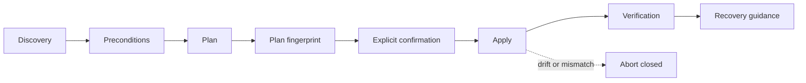

# Architecture

## Scope

NixKeyforge 0.1 is a local Rust CLI and NixOS module. It has no network API,
web server, GUI, daemon, telemetry, or setuid component. The CLI runs
unprivileged for discovery and planning. A future live apply may run as root
only for the exact confirmed operation; NixKeyforge never invokes `sudo`.

The code uses Rust 2024, forbids `unsafe`, and is split into three crates:

```text
nixkeyforge-cli
  ├── nixkeyforge-core       domain rules, plans, fingerprints, redaction
  └── nixkeyforge-system     typed commands and filesystem/system adapters
```

`nixkeyforge-core` has no direct system access. `nixkeyforge-system` converts
validated domain requests into fixed executable/argument structures and uses
an executor trait. Tests supply mock executors. `nixkeyforge-cli` owns command
parsing, confirmation boundaries, output, and exit codes.

## Mandatory operation pipeline



A plan never contains secrets. Before a future live apply can be enabled, its
orchestrator must recheck user, host, configuration revision, file hashes,
device major/minor, LUKS UUID, expected mount role, keyslots, attached
authenticator, assigned role, and fingerprint. The foundation release models
that evidence but does not trust a caller-supplied revalidation flag: every
live PAM, FIDO2, LUKS2, and SSH apply path fails closed.

High-risk operations require a plan file, its fingerprint, and interactive
confirmation. There is no global `--yes`. The development build deliberately
blocks live apply while preserving the typed adapter and test boundaries.

## Domain model

Authenticator roles are `Primary` and `Backup`. Protection domains distinguish
PAM login, display manager, screen locker, LUKS2, and SSH user credentials.
Enrollment states are `Unconfigured`, `Planned`, `Enrolled`, `Verified`,
`Degraded`, `Drifted`, and `Failed`.

Overall health is intentionally conservative:

- `dual-token-ready` requires independent proof for primary and backup across
  every selected domain plus a tested independent recovery route.
- `single-token` and `dual-token-incomplete` are degraded.
- `recovery-unverified` is never green.
- `lockout-risk` wins when password fallback is absent and two independent
  working credentials cannot be proved.
- `configuration-drift` aborts apply.
- `unsupported` prevents planning beyond read-only diagnosis.

Sensitive identifiers have no unredacted `Debug` or serialization. Reports use
stable hashes or counts; PAM key handles, public-key fields, LUKS salts, PINs,
passphrases, and recovery keys are never logged.

## System boundary

Only allowlisted executables are modeled: `pamu2fcfg`, `fido2-token`,
`systemd-cryptenroll`, `cryptsetup`, `ssh`, `sshd`, `ssh-keygen`, `age`, and
Nix inspection commands. There is no generic command option and no `sh -c`,
`bash -c`, `eval`, or composed command string.

The generated-module writer uses a same-directory temporary file, restrictive mode,
content and metadata verification, `fsync`, and atomic rename. Directories and
targets are rejected when symlinks, unexpected hardlinks, ownership, modes, or
file types do not match. The same primitive is tested for a future PAM mapping
writer, but live PAM apply remains disabled until complete fresh evidence is
bound to the operation.

## PAM boundary

PAM services are explicit. TTY `login`, SDDM, KDE/Plasma locker, `sudo`,
Polkit, `su`, SSH PAM, and other discovered services are separate records. The
NixOS module enables only named supported services.

The supported generated profile is password **and** FIDO2: `unixAuth = true`
and per-service U2F control `required`. Global U2F is kept disabled so unrelated
services do not inherit it. `nouserok`, `alwaysok`, credential debug output,
and passwordless apply are unsupported.

The global mapping is mutable runtime state outside the Nix store. Updates
preserve other user lines, reject duplicates, and report only redacted role and
count data.

## LUKS2 boundary

The supported path is systemd initrd plus LUKS2 token metadata enrolled by
`systemd-cryptenroll`, with `fido2-device=auto` and an authenticator supporting
`hmac-secret`. Device path, LUKS UUID, major/minor, mount role, keyslots, and
token metadata are checked before and after enrollment.

Primary and backup are separate additive enrollments. Only the assigned device
may be connected. Version 0.1 cannot remove keyslots, convert LUKS1, restore a
header, disable PIN/touch for convenience, or remove a recovery path.

## Backup boundary

Portable configuration backups contain only configuration, generated modules,
redacted facts, public SSH material, manifests, checksums, and verification
state. Sensitive machine recovery backups are optional and encrypted to
explicit age recipients. Authenticated encryption is the trust boundary;
checksums aid diagnosis but do not authenticate an archive.

The current crate validates a pre-parsed in-memory archive model: paths, entry
types, schema, manifest uniqueness, checksums, target UUID, and a fixed staging
allowlist. This is not yet an Age or tar trust boundary. Consequently the
production writer, CLI verification, and restore staging remain unsupported
until authenticated EOF, truncation, PAX/GNU metadata, parser limits, and
exclusive staging are tested at the byte boundary. LUKS header restore remains
manual in every version 0.1 path.

## NixOS boundary

The flake pins the same NixOS 26.05 revision used for the reference evaluation.
It exports a package, app, development shell, NixOS module, evaluation check,
and hardware-free VM test.

The NixOS module never embeds credential material. It creates only a `0700`
state directory, installs the package, and optionally emits explicit additive
PAM settings. Generated fragments go to a user-selected output directory.
Foreign Nix files are never rewritten.
